# Breathing plant pot

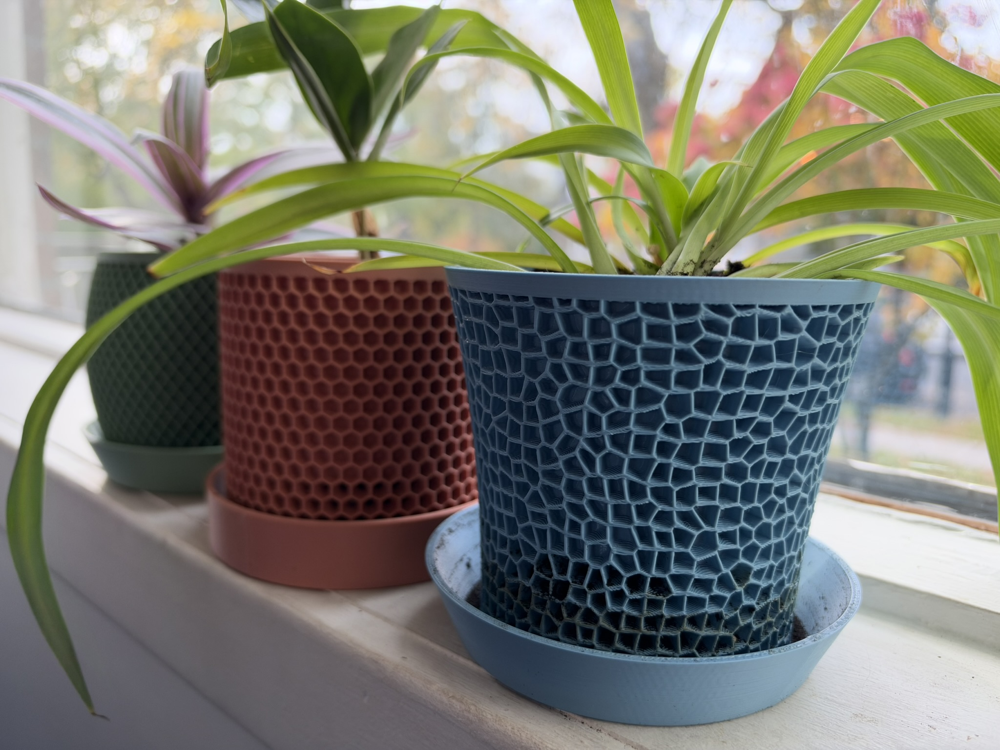

A single-piece, support-free, 3D-printable (FDM) plant pot. The wall is
perforated to let in as much air as possible without losing soil, and a
plain cup fused to the base catches drips and holds a small water reserve
that the soil wicks back up.

The pot is generated from code (an implicit field meshed with marching
cubes, or exact geometry for the patterns that support it) and exported
as STL + 3MF, with a PNG preview.

## Printed examples

<p>
  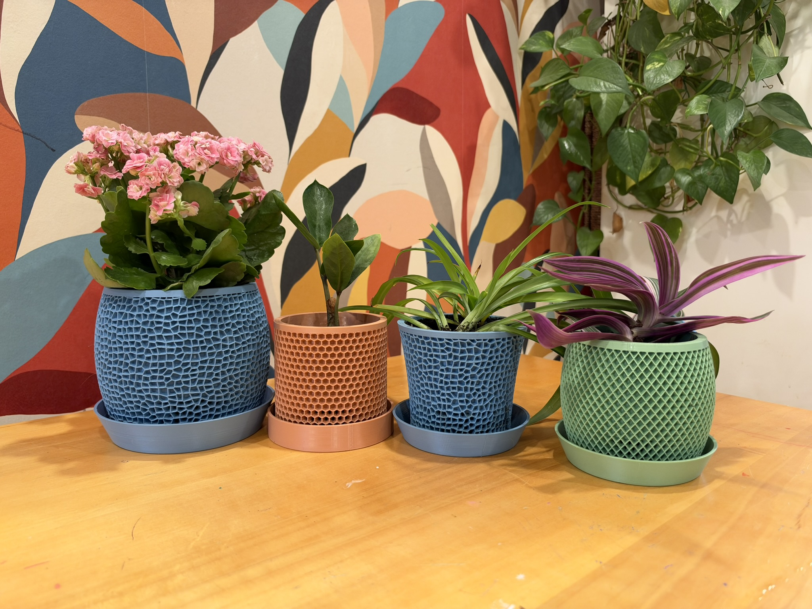
  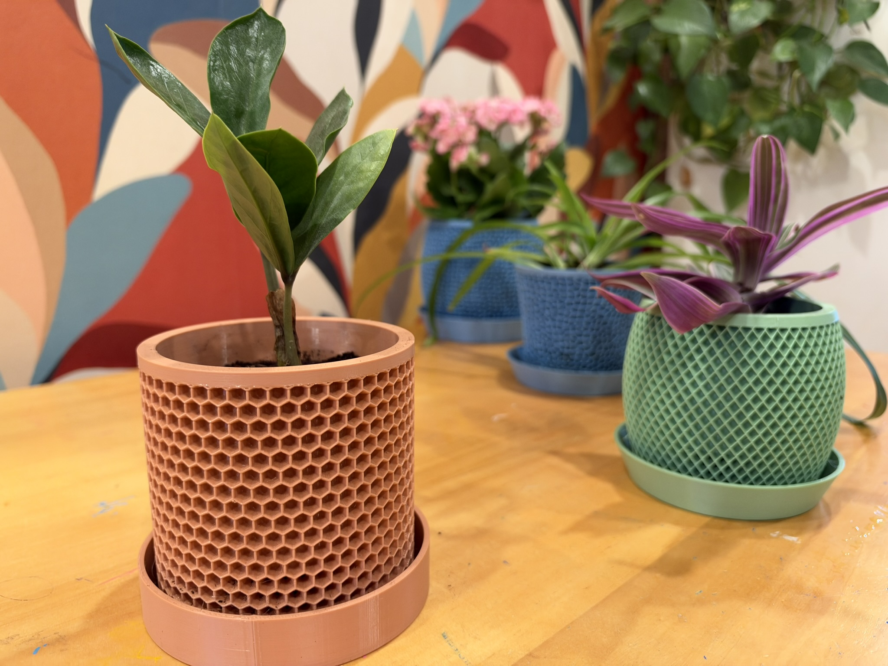
  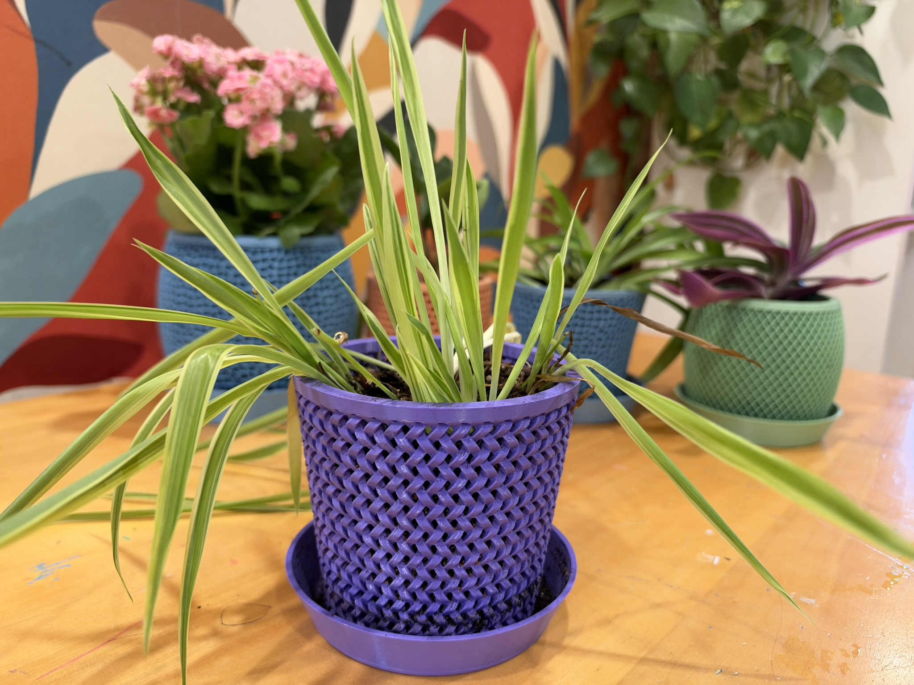
</p>

## Setup

```sh
uv sync                      # or: pip install -e .
```

This installs the `pots` and `pots-gallery` commands into the project venv. Run them with
`uv run pots ...`, or activate the venv and call `pots` directly
(`python -m pots` works too).

## Usage

All settings live in [`src/pots/config/config.yaml`](src/pots/config/config.yaml)
and have defaults. Override only what you want to change, as `key=value`:

```sh
pots                                  # quick draft build with the defaults (size=big)
pots quality=full                     # print-quality mesh, use this for the file you print
pots size=small                       # the 50 mm pot
pots size=small height=65             # start from a preset, change one value
pots pattern=hex design.wall=4        # another pattern, thinner wall
pots holder.enable=true               # also a holder to hang the pot on a wall
pots clip.enable=true                 # or a clip that holds it by the cup alone
pots height=65 --show                 # print the final settings, don't build
pots --all                            # every pattern, one after another
pots -v                               # debug logging
pots --help                           # usage and the list of patterns
```

Settings use Hydra/OmegaConf syntax, so nested keys use dots
(`design.wall=5`, `patterns.lattice.strut_in=2.5`) and a misspelled key is an error.

### Outputs

Written to `out` (default `output/<pattern>_<shape>_h<height>/`):

| File | What |
|---|---|
| `<pattern>_<shape>_h<height>.stl` | print file |
| `<pattern>_<shape>_h<height>.3mf` | same mesh, ~5x smaller |
| `<pattern>_<shape>_h<height>.png` | preview: outside, cut-away, vertical section, both wall faces at true scale with their open % |
| `<pattern>_<shape>_h<height>_holder.stl` / `.3mf` | with `holder.enable=true`: the wall holder, a separate part, lying in its print orientation |
| `<pattern>_<shape>_h<height>_holder.png` | with `holder.enable=true`: the holder on the pot, a section through both, the part as printed |
| `<pattern>_<shape>_h<height>_clip.stl` / `.3mf` / `.png` | with `clip.enable=true`: the cup clip, the same way |
| `config.yaml` | the exact settings used for this pot |

## Parameters

### General

| Key | Default | Description |
|---|---|---|
| `pattern` | `voronoi` | Wall pattern, see [Patterns](#patterns). |
| `shape` | `tapered` | Pot profile, see [Pot shapes](#pot-shapes). |
| `size` | `big` | Size preset: `big` or `small`, see [Size presets](#size-presets-srcpotsconfigsize). |
| `height` | from `size` | Pot height in mm. **Drives the whole shape**, see [Scaling](#scaling-with-height). Minimum `base + rim + 10` (17.4 mm). |
| `preview` | `true` | Also render the PNG preview (~20 s). |
| `out` | `output/${pattern}_${shape}_h${height}` | Output folder; existing files are overwritten. |
| `quality` | `draft` | Mesh quality preset: `draft` (fast check) or `full` (for printing). |
| `mesher` | `auto` | `auto`: exact geometry for the patterns that support it (the tapered ones: `voronoi`, `hex`, `drops`, `lattice`, `isogrid`, `cubes`, `voxel`), marching cubes for the others. `sdf`: marching cubes for every pattern. See [How the mesh is made](#how-the-mesh-is-made). |

### Size presets (`src/pots/config/size/`)

Each preset sets the height and the wall thickness. Anything on the
command line still wins, so `size=small height=65` is a small pot made
65 mm tall.

| Key | `big` | `small` |
|---|---|---|
| `height` | 100 (~118 mm wide with the cup) | 50 (~62 mm wide with the cup) |
| `design.wall` | 6.0 | 4.0 |

### Quality presets (`src/pots/config/quality/`)

| Key | `full` | `draft` | Description |
|---|---|---|---|
| `quality.voxel` | 0.3 | 0.6 | Mesh grid spacing in mm. Time and memory grow ~1/voxel³: on the 100 mm pot (`size=big`) full takes ~45 s, draft ~10 s; a full 130 mm pot needs 2–3 GB RAM. Don't run several full builds in parallel. |
| `quality.faces` | 900 000 | 100 000 | Triangle budget; the mesh is decimated to this. |

The default is `draft`, which is too coarse to print: build the final file
with `quality=full`. You can also override a single value:
`quality=full quality.voxel=0.4`. The quality settings only apply to
marching cubes (`louvers`, `slots`, `spiral`, `chevrons`, `weave`, or any
pattern with `mesher=sdf`): an exactly built pattern is the same, print
ready mesh at any quality.

### Design sizes (`design.*`, mm)

Print-physics sizes: they depend on the nozzle and the soil, not on the
pot size, so they **do not scale** with `height`.

| Key | Default | Description |
|---|---|---|
| `design.wall` | from `size` | Pot wall thickness (radial). The pattern goes through it. Thicker = stiffer, longer funnels; thinner = lighter. 4 mm suits small pots. |
| `design.rim` | 5.0 | Solid band at the top, for stiffness and a clean edge. |
| `design.base` | 2.4 | Solid floor shared by pot and cup. The soil sits on it and wicks water from the cup. The pattern starts 1 mm above it. |
| `design.cup_wall` | 2.4 | Wall thickness of the drip cup. |
| `design.skin` | 1.6 | Solid soil-side layer behind the pattern. Where it is, the holes become blind pockets, so water poured on the soil can't run out through the wall. 0 = holes go right through. |
| `design.skin_frac` | 0.67 | Share of the height, from the top, that gets the skin. Below it the holes stay open for air and drainage into the cup. |

### Pattern settings (`patterns.<name>.*`, `src/pots/config/patterns.yaml`)

Every pattern has its own block in `patterns.yaml`: cell count, strut or
slot widths, jitter, warp, and so on, each documented there. Only the block
of the selected `pattern` is used. Override like any other key:

```
pots pattern=lattice patterns.lattice.strut_in=2.5
pots pattern=voronoi patterns.voronoi.seed=3 patterns.voronoi.cells=60
```

Keys most patterns share:

| Key | Description |
|---|---|
| `cells` | Cells around the pot at the 130 mm reference height; scaled with `height` (see [Scaling](#scaling-with-height)). More cells = smaller holes. |
| `strut_in` | Tapered patterns (`voronoi`, `hex`, `drops`, `lattice`, `isogrid`, `cubes`, `voxel`): strut width on the soil side (2.2 mm; `lattice` 3.0; the cube patterns 1.4, their holes are smaller). Wider = smaller inner holes = less soil loss, less air. Keep ≥ ~1.1 (0.4 mm nozzle). |
| `strut_out` | Tapered patterns: strut width on the outside (`voronoi` and the cube patterns 0.5, `lattice` and `isogrid` 0.3, `hex` and `drops` 1.1 mm). Keep ≤ `strut_in` so holes widen outward. The strut is a wedge through the wall, so one face may be thinner than the nozzle as long as the other is not (`pots` warns only when both are below ~1.1 mm): the slicer just trims the tip and the holes on that face get a little bigger. |
| `center` | Tapered patterns, 0 to 1 (1 on `voronoi`, `drops`, `lattice`, `isogrid`; 0 on `hex`). 0 keeps each hole roof where it is from the soil side out, so holes grow only sideways and downward. 1 moves the soil-side pattern down so each hole is centred on its outside opening; the roof then rises 0.6–1 mm across the wall. On `voronoi`, `hex`, `isogrid` and the cube patterns (flat or 30° bridge roofs) that makes sloped ceilings that may sag, and `pots` warns; `drops` and `lattice` have pointed roofs and barely change. |

With the defaults, on the 100 mm pot (6 mm wall):

| pattern | outside face | soil side |
|---|---|---|
| `voronoi` | 78% open, holes ~4.2 mm | 29% open, holes ~2.5 mm |
| `hex` | 67%, ~4.7 mm | 42%, ~3.8 mm |
| `drops` | 56%, ~4.4 mm | 34%, ~3.4 mm |
| `lattice` | 85%, ~4.1 mm | 13%, ~1.6 mm |
| `isogrid` | 85%, ~3.8 mm | 24%, ~2.1 mm |
| `cubes`, `voxel` | 69%, ~2.4 mm | 30%, ~1.6 mm |

At 2.2 / 1.1 mm struts `voronoi` is 58% (3.6 mm) outside and 29% (2.5 mm)
inside. `pots` logs these numbers for every build. The 55° roof slope and
the warp frequencies are not settings: they keep the pot support-free and
seamless.

## Scaling with height

`height` sets a scale factor `k = height / 130` applied to everything that
defines the *shape*:

- outer radius: 56·k at the bottom, 72·k at the top (`shape=tapered`;
  every shape stays between those two)
- cup height (28·k) and moat gap at the bottom (5·k); the cup lip always
  sits 1 mm outside the widest part of the pot above it so drips land in it
- number of pattern cells around the pot, rounded to an integer so the
  pattern stays seamless and each cell keeps its size in mm

What stays fixed in mm: the `design` sizes, hole size, row height of the
cells, the lip overhang and the bottom chamfer. So a small pot has fewer,
same-size holes and a proportionally thicker wall.

## Pot shapes

Pick one with `shape=<name>` (`pots shape=barrel`). Top: the 100 mm pot
(`size=big`) in each shape with the default pattern. Bottom: a vertical
section through the middle, with the soil and the water the moat holds when
the cup is filled to the lip.

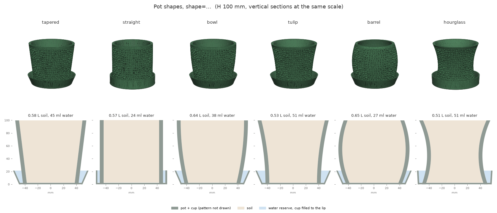

| `shape=` | Profile |
|---|---|
| `tapered` | Cone, narrow at the bottom. Default. |
| `straight` | Cylinder. Least water: the moat is only the 5·k mm gap. |
| `bowl` | Flares fast low down, near vertical at the rim. |
| `tulip` | Near vertical low down, flares out at the rim. |
| `barrel` | Bulges out a little above mid-height, narrower rim. Most soil. |
| `hourglass` | Narrow waist a little below mid-height. |

Every shape stays between the same narrowest and widest radius (56·k and
72·k mm). The patterns are drawn for that range, so every pattern keeps its
hole sizes, strut widths and 45° roofs on every shape (the voronoi wall is
open about the same on all six). No wall leans more than 24° from vertical, and
the cup follows the shape: it starts a moat gap out from the pot and its lip
sits just outside the widest part of the wall above it.

## Wall holder

`pots holder.enable=true` also makes a holder that hangs the pot on a wall.
It is a separate part and **the pot does not change**, so it fits pots you
have already printed (build it with the same `height`, `shape` and
`design.*` they were printed with).

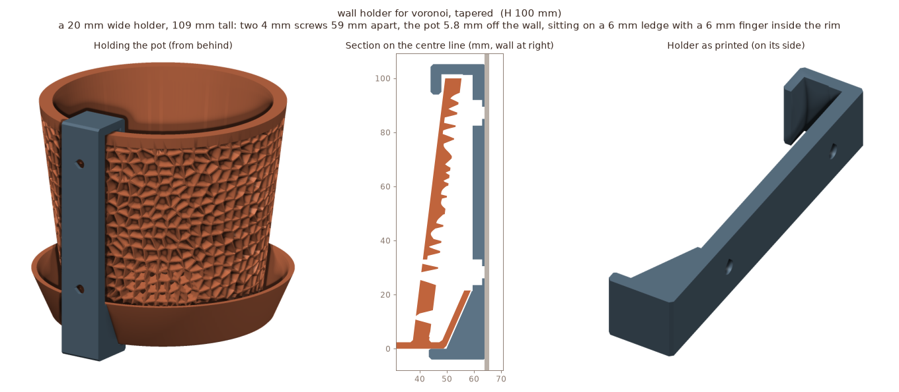

A back plate is screwed to the wall (two screws, heads sunk into the front
of the plate, behind the pot). At the top a bridge reaches over the rim and
a finger hangs down inside it. At the bottom a seat hugs the back of the
cup, with a ledge under the base. The ledge carries the pot. The pot's
weight is on its axis, in front of the ledge, so the pot wants to tip
forward, and the finger inside the rim stops it. Every face that touches
the pot follows its surface, `holder.clear` off it, for every shape and
height.

**Hanging the pot:** tilt its bottom out a little, slide the back of the rim
up into the hook, swing the bottom in over the ledge and let it down onto
it. Take it off the same way backwards: lift it as far as the hook
allows (`holder.lift`), swing the bottom out, and drop it off the finger. The tests check
that this works for every shape: the bottom swings out 4 to 6 degrees on a
100 to 130 mm pot, and up to ~13 degrees on a 50 mm one.

It prints lying on its side, with no supports. Every layer is the same
section, and only the two screw holes cross the layers, so they get
teardrop roofs. Pots under ~46 mm need a narrower `holder.width`; the
holder needs a pot of at least ~40 mm.

| Key | Default | Description |
|---|---|---|
| `holder.enable` | false | Also make the holder. |
| `holder.screw` / `head` / `head_h` | 4 / 9 / 3 | The wall screws: shank and head diameter, head thickness. The plate is `head_h` + `clear` + 1.6 mm thick. |
| `holder.clear` | 0.2 | Air between the holder and the pot, and around the screws. 0 means the faces touch the pot (a press fit); 0.2 fits snugly. |
| `holder.width` | 20 | Width across the back of the pot. At least ~15.6 mm (a counterbore and its teardrop roof), at most the pot's narrowest radius. |
| `holder.thick` | 4 | Thickness of the bridge, the finger and the ledge. |
| `holder.groove` | 3 | How deep the rim sits up in a groove under the bridge: the groove's outer side follows the outside of the rim, the finger its inside. At most `drop`. |
| `holder.drop` | 6 | How far the finger reaches down inside the rim. |
| `holder.ledge` | 6 | How far the ledge reaches in under the base. Longer means more bearing, but the pot has to swing further out to come off. |
| `holder.lift` | 0 | Air above the rim: how far the pot lifts before it swings out. 0 means the bridge lies on the rim. |

## Cup clip

`pots clip.enable=true` makes another wall mount, which holds the pot by its
cup alone, with a tight fit. Like the holder, it is a separate part and the
pot does not change. It is made for the standard tapered pot (the tests only
check that shape).

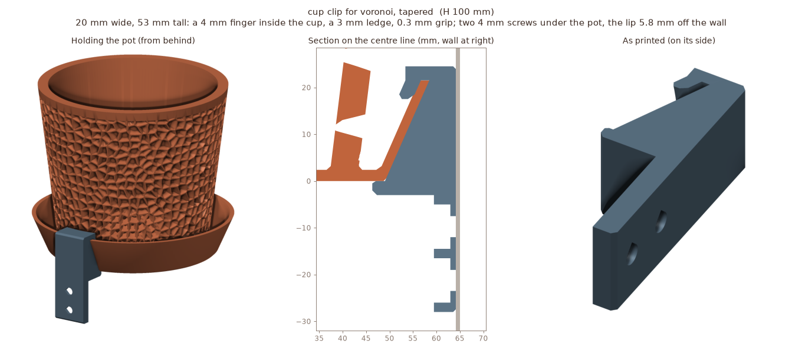

It is a strip 20 mm wide (`clip.width`): a plate on the wall and a hook
whose inside has the shape of the back of the cup wall. A finger follows
the inside of the cup 4 mm down (in the moat between the cup and the pot
wall), the bridge lies on the lip, the back follows the outside of the cup
all the way down, and a ledge reaches under the base. The ledge carries the
pot. The pot's weight is in front of the ledge, so the pot tips forward and
the finger inside the cup stops it. Everywhere the clip touches the cup, it
presses `clip.squeeze` (0.3 mm) into it, so the cup wall sits tight in its
slot. The screws go through the clip behind the cup. Their counterbores
open in the seat, so you drive them in from the front before the pot goes
on, and the heads end up sunk behind the cup. They have to stay below the
finger's tip, so a 130 mm pot has room for two, one above the other, and
smaller pots for one. On pots under ~70 mm that one cuts a notch through the
middle of the ledge, and the clip reaches a little below the ledge.

**Hanging the pot:** tilt its bottom out, push the back of the cup wall up
into the slot, and swing the bottom in over the ledge until it snaps in.
Take it off the same way backwards. The slot follows the cup wall exactly,
so the pot can't swing in or out without something giving: the lip pushes
the back of the hook out as it goes. With the best swing (6 to 10 degrees)
that is about 0.5 mm on a 100 to 130 mm pot and 0.9 mm on a 50 mm one, plus
the squeeze (the tests check it stays under 0.7 and 1 mm).

**How firm:** with the clip on the cup, the pot's tipping moment is taken
over a short height, so the finger pushes on the inside of the cup with
about 5 times the pot's weight. That is ~40 N for a wet 100 mm pot and
~90 N for a 130 mm one. The holder's finger, at the rim, takes ~5 to 10 N.
The load lands on the cup's 2.4 mm wall rather than the pot's 5 mm rim.
These are estimates, not measured on a print.

It prints lying on its side, with no supports, like the holder.

| Key | Default | Description |
|---|---|---|
| `clip.enable` | false | Also make the clip. |
| `clip.screw` / `head` / `head_h` | 4 / 9 / 3 | The wall screws: shank and head diameter, head thickness. |
| `clip.clear` | 0.5 | Air between the finger and the pot wall, and around the screws. |
| `clip.width` | 20 | Width of the strip. At least ~15.6 mm, at most the pot's narrowest radius. |
| `clip.thick` | 3 | Thickness of the bridge, the ledge and the finger. The finger gets thinner where the moat is narrower, down to 1.2 mm. |
| `clip.drop` | 4 | How far the finger reaches down inside the cup. Longer holds better, but the snap gets stiffer. |
| `clip.ledge` | 3 | How far the ledge reaches in under the base. |
| `clip.lift` | 0 | Air above the cup lip. 0 means the bridge lies on the lip. |
| `clip.squeeze` | 0.3 | How far the clip presses into the cup wall on each side: the grip. 0 is snug with no grip. |

## Patterns

Pick one with `pattern=<name>`. Each image shows the 50 mm pot (`pots-gallery size=small`)
from outside, next to a 40 x 30 mm true-scale swatch of the outer wall face
(white = open) with its open %.

| | |
|---|---|
| **`voronoi`** (default), 2D, tapered: organic cells that flare outward like funnels. <br> 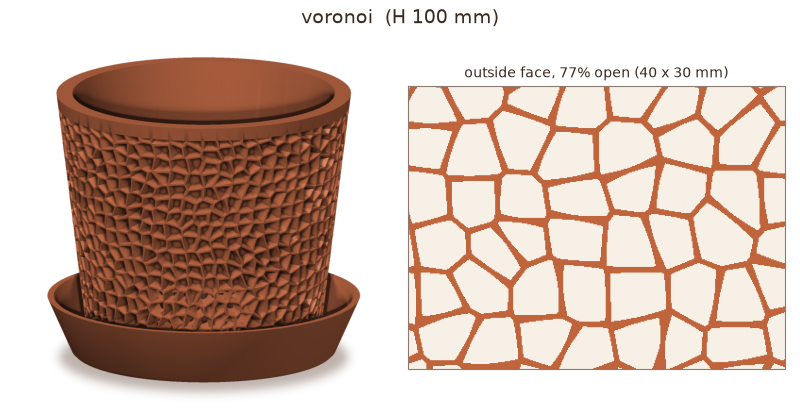 | **`hex`**, 2D, tapered: regular honeycomb, pointy-top cells about 6 mm across, flaring outward like `voronoi` (`warp` / `warp_z` make it wavy). <br> 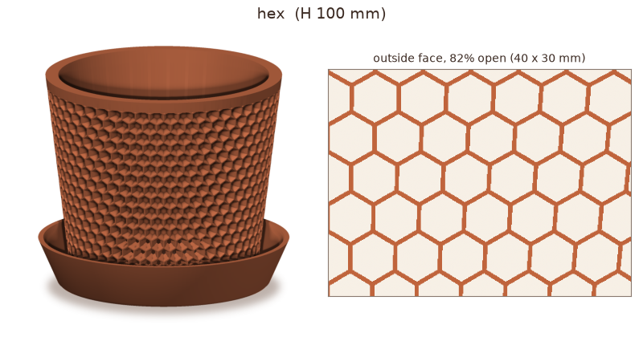 |
| **`drops`**, 2D, tapered: staggered teardrops with 55° pointed tops, flaring outward. <br> 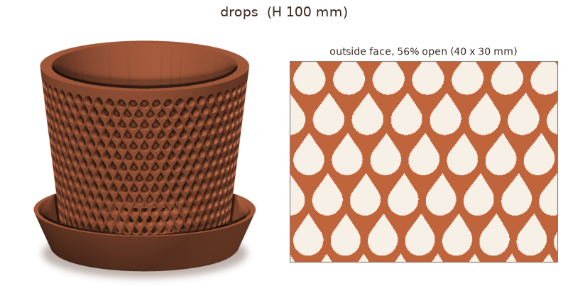 | **`lattice`**, 2D, tapered: diamond trellis of helical strips crossing at ±55°, no bridges at all, flaring outward like `voronoi`. <br> 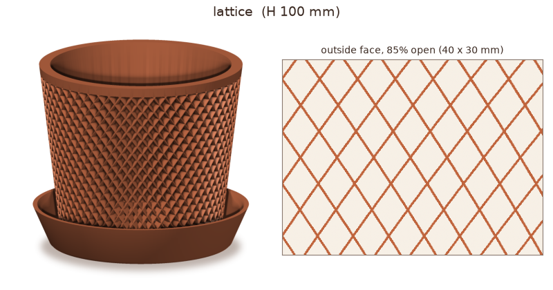 |
| **`isogrid`**, 2D, tapered: triangle grid flaring outward like `voronoi`; the downward triangles have short flat bridges. <br> 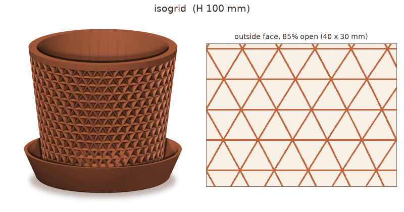 | **`cubes`**, 2D, tapered: tumbling blocks, the classic isometric cube illusion: each cube a top diamond and two side faces, 60° rhombi with vertical and 30° edges (the roofs are 30° tents, as on `hex`). Flares outward like `voronoi`. <br> 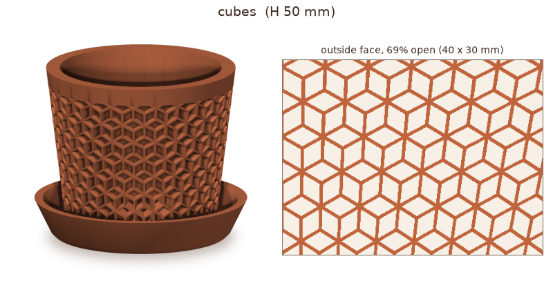 |
| **`voxel`**, 2D, tapered: the same cubes reshuffled at random into stacks and hollows (random cube flips of the tiling, `sweeps` rounds; `seed` picks another stacking). <br> 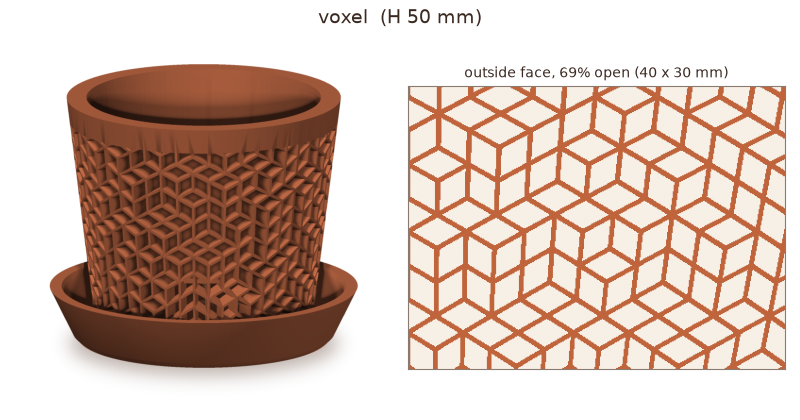 | **`louvers`**, 2D: gills that run down and outward through the wall like shutter blades. No line of sight: soil stays in, rain runs off. <br> 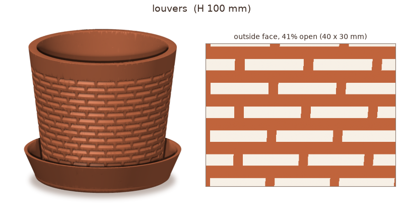 |
| **`slots`**, 2D: narrow wavy vertical slots, air-pruning style. <br> 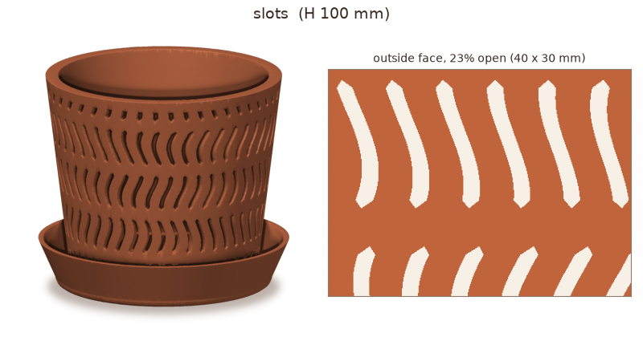 | **`spiral`**, 2D: slots on a many-start 60° helix. <br> 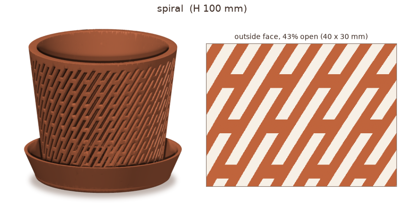 |
| **`chevrons`**, 2D: stacked arrowhead slots. <br> 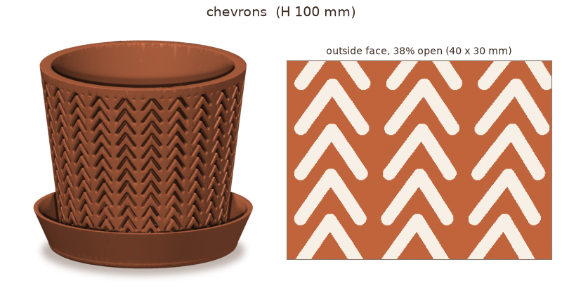 | **`weave`**, 3D: two sets of strips woven over and under through the wall (the swatch shows only where they touch the outer face). <br>  |

2D patterns are cut radially through the wall (louvers slope down through
it). All wrap seamlessly around the pot.
Sloped hole roofs are at least 55° from horizontal in the unrolled pattern,
so at least 45° on the real, tapered pot, and no hole closes into a loop,
so the wall is always one piece.

### Regenerating the gallery

`pots-gallery` builds every pattern one after another, in memory, and
writes only these images to `docs/patterns/<name>.png` (no STL, 3MF or
config; use `pots pattern=<name>` for a printable pot).

```sh
pots-gallery size=small               # every pattern, as in this README (a few minutes)
pots-gallery hex slots                # only these (100 mm pot by default)
pots-gallery quality=draft            # faster, coarser
pots-gallery --images pics            # images in pics/
pots-gallery height=90 design.wall=5  # any shape setting of `pots`
pots-gallery --shapes                 # only docs/shapes.png: every pot shape (~1 min)
```

It takes the shape settings of `pots` (`size`, `height`, `design.*`,
`quality`). Mesh quality defaults to `quality.voxel=0.35
quality.faces=400000` (between draft and full, fine enough for the 1.1 mm
struts to show); any `quality=...` or `quality.*` on the command line
replaces that. Run it after changing a pattern so the README stays current.

## Printability rules

The generator follows these; keep them when changing the code:

- No supports anywhere.
- Every hole roof is a flat bridge no wider than the hole (≤ ~5 mm), or a
  slope of at least 45°. The taper is done by shifting the pattern down as
  its edges recede, so holes only grow sideways and downward; a ceiling
  never rises toward the outside. The exception is a tapered pattern's
  `center` setting, which trades that for centred holes (`pots` warns when
  it tilts a flat bridge: `voronoi`, `hex`, `isogrid`, `cubes`, `voxel`).
- Minimum strut ~1.1 mm (0.4 mm nozzle); a tapered strut is a wedge, so it
  may thin below that on one face (its tip) as long as the other face is
  at least that thick.
- 45° chamfer on the bottom outer edge (elephant foot).
- Every pattern is periodic around the circumference.

## Using it from Python

```python
from pots import Pot, generate
from pots.metrics import wall_metrics

pot = Pot(height=65, wall=4.0)                 # every size of one pot
mesh, field = generate(pot, "voronoi", voxel=0.6, faces=100_000)
mesh.export("pot.3mf")
print(wall_metrics(field, pot))                # open %, hole size on both faces
```

## Code layout

```
src/pots/
  cli.py        `pots` command: config, build, export, preview
  gallery.py    `pots-gallery` command: every pattern + README images
  config/       Hydra config: config.yaml and the quality/ and size/ presets
  geometry.py   Pot: all dimensions, scaled from the height
  patterns.py   wall patterns (PATTERNS registry)
  field.py      make_field(): wall + rim + base + cup as one implicit field
  sdf.py        field helper (smin)
  mesh.py       slab-wise marching cubes, decimation and repair
  solid.py      exact mesh: revolved pot minus lofted hole cutters (manifold3d)
  pipeline.py   generate(): exact or marching-cubes mesh, plus the field
  holder.py     Holder: the separate wall holder (manifold3d)
  clip.py       Clip: the separate cup clip (manifold3d)
  metrics.py    open %, hole size and straight-through % of both wall faces
  preview.py    PNG preview and the small gallery image
tests/          pytest suite (uv run pytest)
docs/patterns/  gallery images used in this README (pots-gallery)
docs/shapes.png pot shape sheet (pots-gallery --shapes size=big)
docs/holder.png the wall holder (pots holder.enable=true)
docs/clip.png   the cup clip (pots clip.enable=true)
```

### How the mesh is made

Every pattern is defined as an implicit field (negative = solid). By
default it is meshed with marching cubes in z-slabs, then decimated,
reduced to its largest body and repaired. That works for any shape, but a
grid can't follow a sharp edge that runs across it: flat ribs come out
with sawtooth edges, and it takes many triangles.

The tapered patterns (`voronoi`, `hex`, `drops`, `lattice`, `isogrid`,
`cubes`, `voxel`) can also give their hole outlines directly (`Pattern.cutters`). Then
`solid.py` builds the pot exactly with
[manifold3d](https://github.com/elalish/manifold): the plain pot is
revolved from its profile, each hole is a loft from its soil-side outline
to its outside one, and all holes are subtracted at once. Faces are flat,
edges sharp, curved hole sides (voronoi's cell edges are hyperbola arcs)
smooth, and it is watertight by construction. On the 100 mm pot
(`size=big`), against marching cubes at `quality=full` (~45 s, 900 000
faces, 45 MB STL for every pattern):

| pattern | exact build | faces | STL | whole `pots` run (no preview) |
|---|---|---|---|---|
| `voronoi` | 3.9 s | 292 000 | 14 MB | 14 s |
| `hex` | 3.5 s | 253 000 | 13 MB | 10 s |
| `drops` | 3.1 s | 200 000 | 10 MB | 8 s |
| `lattice` | 1.6 s | 99 000 | 5 MB | 6 s |
| `isogrid` | 2.4 s | 179 000 | 9 MB | 7 s |
| `cubes`, `voxel` | 2.0 s | 185 000 | 9 MB | 6 s |

The exact mesh follows the field to within ~0.03 mm: the hole volume
matches the field's within 1% on every shape and size (tested; most are
within 0.5%). Small differences: the field's 1 mm rounded blends where the
wall meets the base and cup become 0.8 mm 45° chamfers; a lattice whose
holes close up inside the wall (a strut wider than the cell) falls back to
marching cubes; and the overhang share reads a little higher (hex 14.9%
vs 13.4%) because the sloped hole roofs stay sharp instead of being
rounded off.

Either way, each build logs whether the mesh is watertight and a single
body, plus the wall metrics (which always come from the field).

Hydra note: the config is loaded with Hydra's compose API rather than
`@hydra.main`, because hydra-core 1.3's own CLI crashes on Python 3.14.
The `key=value` syntax is the same; `--show` replaces `--cfg job`.

## Development

```sh
uv sync            # installs the dev group (pytest) too
uv run pytest      # ~50 s, includes small draft and exact builds
uv run pytest -m slow   # ~3 min: builds every pattern and every shape, checks for loose parts and overhangs
```
